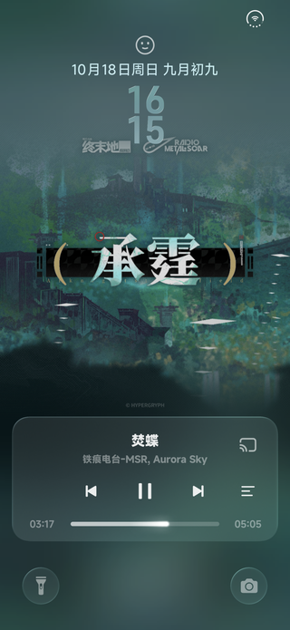
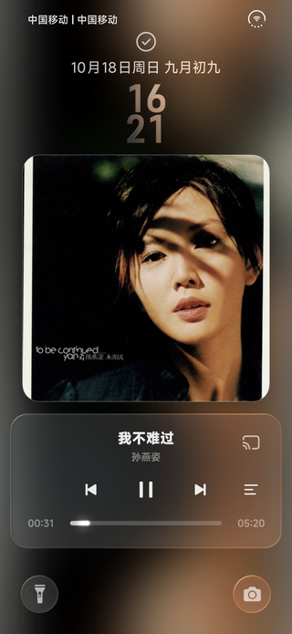
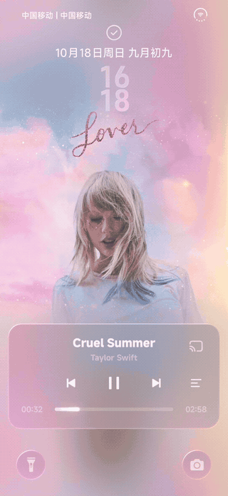
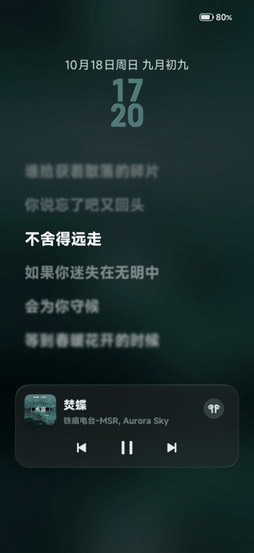
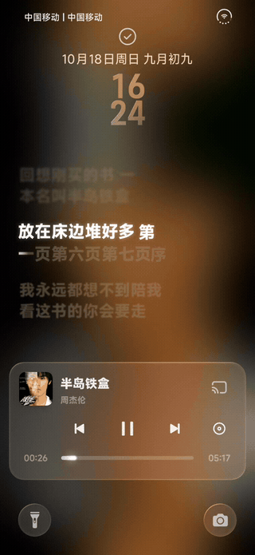
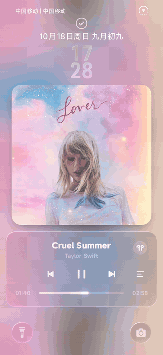
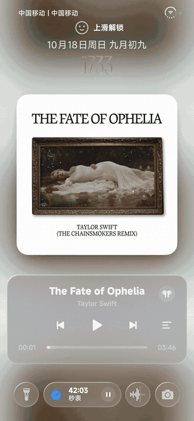
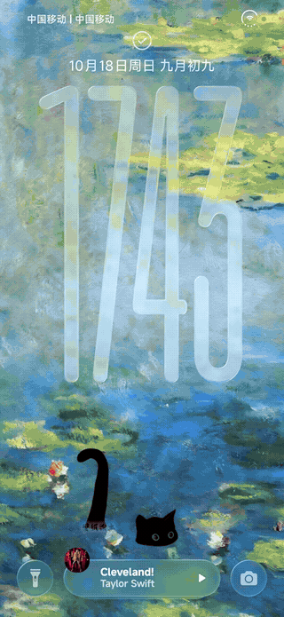
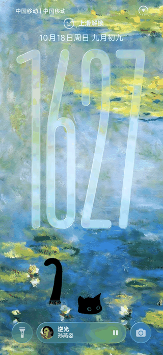
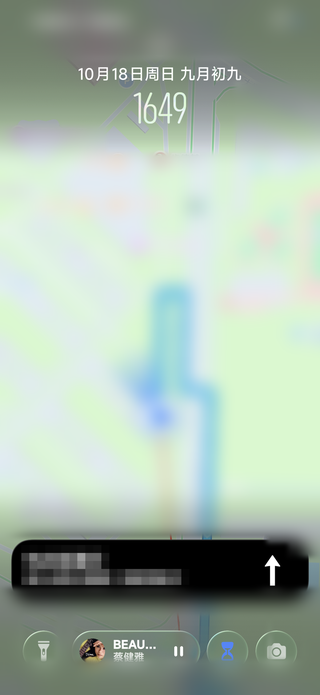

# HyperMusicCover

### "一个 HyperOS 4 音乐锁屏模块"

---

## 简介

HyperMusicCover 是一个**澎湃 OS 4（HyperOS 4）** 的音乐锁屏模块，尝试把系统锁屏变成沉浸式的音乐播放页面，同时把通知、音乐和导航统一收进锁屏超级岛。

- **封面即壁纸**：全屏专辑封面替换锁屏壁纸纹理，媒体卡和通知卡的模糊、时钟的玻璃折射都采样同一张图
- **时钟让位**：跟随媒体卡片收缩，液态玻璃连续过渡成实心，颜色跟着封面走
- **锁屏歌词**：逐字动画、翻译、罗马音，支持对齐和 HDR 高光
- **锁屏超级岛**：音乐、通知、导航，一个岛装下

> 非官方应用，与小米、Apple 均无关联。本模块不提供、不内置任何音乐或歌词内容，播放与取词均来自你设备上已有的应用和服务。

## 功能概览

- **三种封面形态**：全屏封面、方形卡片、保留壁纸（只推时钟与歌词）
- **动态封面**：支持 Apple Music 的动态专辑封面，以及视频壁纸
- **锁屏歌词**：逐字扫光、翻译、罗马音、左中右对齐、HDR 高光、播放时常亮
- **媒体卡片**：点击歌名暂停、方形卡片、滑动淡出，以及原生媒体卡与迷你播放器之间的形变
- **锁屏超级岛**：并排 / 堆叠两种排列，普通通知按应用合并，支持高德导航、公交地铁逐站提醒和 AOD 显示
- **通知与指纹**：隐藏锁屏指纹图案与动画、通知避让、通知下沉

> 功能仍在持续调整中，实际可用功能会随版本产生变化。

## 兼容性与已知问题

- **仅支持Hyper OS 4**。HyperOS 3 及其他 ROM 未适配

<h2 align="center">软件界面预览</h2>

<em>截图取自 HyperOS 4 实机，不同机型、主题和壁纸下效果可能不同。</em>

<h3 align="center">锁屏封面</h3>

<table>
  <tr>
    <td align="center"> 全屏封面</td>
    <td align="center"> 方形封面</td>
    <td align="center"> 视频封面</td>
  </tr>
</table>

<h3 align="center">时钟与歌词</h3>

<table>
  <tr>
    <td align="center"> AOD 歌词</td>
    <td align="center"> 逐字歌词</td>
    <td align="center"> 歌词与封面的切换动画</td>
  </tr>
</table>

<h3 align="center">锁屏超级岛</h3>

<table>
  <tr>
    <td align="center"> 并排</td>
    <td align="center"> 堆叠</td>
    <td align="center"> 音乐岛</td>
    <td align="center"> 导航岛</td>
  </tr>
</table>

## 免责声明

本模块仅供学习、研究与个人使用。使用本模块即表示你理解并接受：

- 模块会修改系统界面进程的行为，可能导致锁屏显示异常、耗电增加或系统不稳定，请自行承担风险
- 请遵守你所在地区的法律法规，以及所使用音乐服务与内容平台的服务条款和版权规定
- 本项目不提供任何音乐、歌词或视频资源，也不对第三方来源的可用性、准确性负责
- 因使用本模块造成的设备故障、数据丢失问题，作者不承担责任
- 如你认为本项目侵犯了你的权益或违反许可证，请通过 [Issues](https://github.com/zyl6932/HyperMusicCover/issues) 联系

## 许可证与第三方声明

本项目的自有代码以 **GNU Affero General Public License v3.0（AGPL-3.0）** 发布，全文见 [LICENSE](./LICENSE)。

- 基于或改编自第三方项目的文件，仍保留其原有许可证，具体范围见 [NOTICE](./NOTICE)
- 第三方组件包括 GPL-3.0（KernelSU、HyperLyrics Enhanced 部分文件）、Apache-2.0（HyperNavBar、miuix、AndroidLiquidGlass、HyperChanger、HyperLyrics Enhanced 部分文件）以及作为依赖使用的 accompanist-lyrics-core
- 按 AGPL-3.0 的要求，分发本模块或其修改版时，必须同时提供完整的对应源代码
- 应用内「关于 → 第三方许可证」列出了随包使用的全部开源项目与许可证文本

## 开源致谢

这个模块是站在下面这些项目的肩膀上做出来的。完整名单见应用内「关于 → 致谢」。

- [HyperNavBar](https://github.com/HyperNavBar/HyperNavBar) — 界面骨架、主题
- [miuix](https://github.com/compose-miuix-ui/miuix) — 设置界面使用的全部 Compose 组件与动效参数
- [AndroidLiquidGlass](https://github.com/Kyant0/AndroidLiquidGlass) — 液态玻璃组件库
- [HyperChanger](https://github.com/ColdP/HyperChanger) —景深限制解除、锁屏搭配数量上限、时钟冒号与柔光玻璃
- [HyperLyrics Enhanced](https://github.com/juren233/HyperLyrics-Enhanced) — QQ 音乐取词与解密、TTML Hub 目录、歌曲匹配规则
- [accompanist-lyrics-core](https://github.com/6xingyv/accompanist-lyrics-core) — TTML、LRC、YRC、KRC 解析
- [InstallerX](https://github.com/iamr0s/InstallerX) — 更新交给系统安装器、隐藏图标与拨号密令的做法
- **ColorOS Live Lyrics Bridge** — 动态封面的思路：从 Apple Music 页面取视频并在锁屏播放
- **AMLL / amll-ttml-db** — 歌词动画手感与逐字歌词数据
- **autopickupisland** — 取餐码的整套做法：ColorOS PCR 插件、云端品牌规则与卡片素材

<h2 align="center">Star History</h2>

<a href="https://www.star-history.com/#zyl6932/HyperMusicCover&Date">

 <picture>
   <source media="(prefers-color-scheme: dark)" srcset="https://api.star-history.com/svg?repos=zyl6932/HyperMusicCover&type=Date&theme=dark" />
   <source media="(prefers-color-scheme: light)" srcset="https://api.star-history.com/svg?repos=zyl6932/HyperMusicCover&type=Date" />
   
 </picture>

</a>

---

Made with LSPosed & Jetpack Compose · HyperMusicCover

